# 🚀 AD Model - End-to-End Development & Training Suite

Ye suite aapke proprietary AI model **"AD"** ko create, train, evaluate aur deploy karne ke liye design kiya gaya hai. 

---

## 🏗️ Architecture Overview

```mermaid
flowchart LR
    A["Raw Business Data & Website Crawls"] --> B["Teacher LLM (GPT-4o / Claude 3.5 / Gemini)"]
    B --> C["Synthetic Dataset (ad_train_dataset.jsonl)"]
    C --> D["Base Model (Qwen 2.5 7B / Llama 3.1 8B)"]
    D --> E["Unsloth QLoRA Fine-Tuning"]
    E --> F["Trained AD Model Weights"]
    F --> G["vLLM / Ollama Serving (Port 8000)"]
    G --> H["Ai Chat Web App (BiharStack AI)"]
```



---

## 📋 Step-by-Step Execution Guide

### Step 1: Ultra Combinatorial Dataset Generate Karein (Millions of Samples)
Har vertical (E-Commerce, Healthcare, Education, Real Estate, Restaurant, SaaS), dialect (Hinglish/Hindi/English), aur intent ke millions permutations generate karne ke liye:

```bash
# 20,000 multi-turn samples generate karein (Takes ~0.2s):
python3 ad_model/generate_ultra_dataset.py 20000 ad_model/ad_train_dataset_ultra.jsonl

# 100,000+ compressed samples generate karein (Takes ~1.5s, only ~5 MB disk space):
python3 ad_model/generate_ultra_dataset.py 100000 ad_model/ad_train_dataset_100k.jsonl.gz

# 1,000,000 (1 Million) samples generate karein:
python3 ad_model/generate_ultra_dataset.py 1000000 ad_model/ad_train_dataset_1m.jsonl.gz
```

---

### Step 2: Model Train Karein (Google Colab / RunPod / Local GPU)

1. **Requirements:** 
   - 1x GPU with 16GB-24GB VRAM (NVIDIA RTX 3090, 4090, ya A100).
2. **Install Unsloth (2x faster, 70% VRAM saving):**
   ```bash
   pip install "unsloth[colab-new] @ git+https://github.com/unslothai/unsloth.git"
   pip install --no-deps "xformers<0.0.27" "trl<0.9.0" peft accelerate bitsandbytes
   ```
3. **Training Run Karein:**
   ```bash
   python3 ad_model/02_train_ad_unsloth.py
   ```
   Ye script base model **Qwen 2.5 7B-Instruct** (world-best multilingual & reasoning) ko 4-bit QLoRA ke sath train karegi aur `ad_model_checkpoints/` me save karegi.

---

### Step 3: AD Model Ko Serve Karein (vLLM High-Performance API)

Inference server start karne ke liye:

```bash
chmod +x ad_model/03_serve_ad_vllm.sh
./ad_model/03_serve_ad_vllm.sh ./ad_model_checkpoints/ad_model_merged_16bit 8000
```

Ye OpenAI-compatible API start karega:
- **URL:** `http://localhost:8000/v1`

---

### Step 4: Is Next.js Web App Me AD Model Connect Karein

Apne `.env.local` file me bas ye lines add karein:

```env
# AD Model Integration
LLM_PROVIDER=ad
AD_MODEL_ENDPOINT=http://localhost:8000/v1
AD_MODEL_NAME=ad-model
```

Ab aapka web app jab bhi chat request bhejega:
1. Sabse pehle aapke khud ke **AD Model** ko call karega.
2. Agar kisi karan se AD server down ho, toh bina user ko error dikhaye **Gemini 1.5 Flash** par seamlessly fallback karega!

---

### Step 5: Test & Benchmark Karein

Model ki accuracy, Hinglish samajh aur zero-hallucination test karne ke liye:

```bash
python3 ad_model/04_evaluate_ad.py
```
